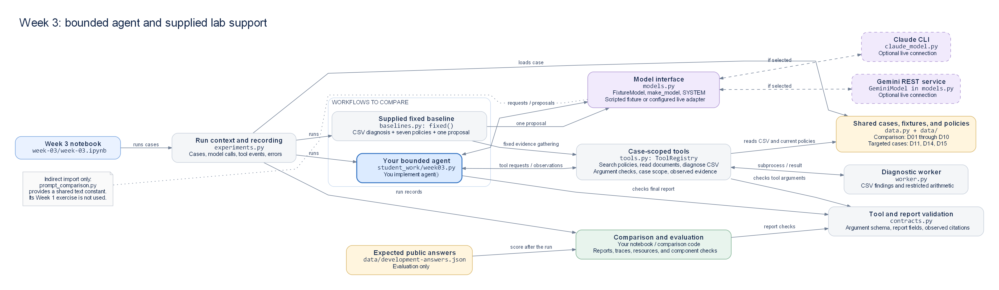

# COSC-651 Labs

Student notebooks, unfinished implementation functions, supplied tools, and synthetic public data for COSC-651: Agentic AI at Maryville University.

Start from this repository before Week 1. Keep your work in your individual course repository and give the instructor access. The assigned lab, submission requirements, and course rubric in Canvas define the work to complete.

The shared Python support is in `src/maintenance_course/`. Public cases, CSV fixtures, versioned policies, and scoring labels are in `data/`. Use expected labels for evaluation, outside model requests. The tests check supplied infrastructure; passing them does not complete an assignment.

| Week | Notebook | Student implementation |
| --- | --- | --- |
| 1 | [Three prompt versions](week-01/week-01.ipynb) | Prompt replies and comparisons in the notebook or your chosen files |
| 2 | [Reflection and feedback](week-02/week-02.ipynb) | [week02.py](student_work/week02.py) |
| 3 | [Bounded tool use](week-03/week-03.ipynb) | [week03.py](student_work/week03.py) |
| 4 | [MCP and state](week-04/week-04.ipynb) | [week04.py](student_work/week04.py) |
| 5 | [Evaluation](week-05/week-05.ipynb) | [week05.py](student_work/week05.py) |
| 6 | [Planning and recovery](week-06/week-06.ipynb) | [week06.py](student_work/week06.py) |
| 7 | [Agent collaboration](week-07/week-07.ipynb) | [week07.py](student_work/week07.py) |
| 8 | [Integrated application](week-08/week-08.ipynb) | [week08.py](student_work/week08.py) |



[Week 3 diagram as SVG](week-03/context.svg). Python support filenames in the diagram are under `src/maintenance_course/`; the student implementation is under `student_work/`.

## Run the supplied checks

Use the configured course Python environment. From this checkout's root:

```bash
python -m pip install -e ".[course]"
python -m pytest
python -m maintenance_course.cli run --case D01 --output artifacts/readiness.json
```

Open the notebook for the assigned week from either the repository root or that week's folder. The notebook locates the shared sources in this checkout. Keep unfinished student functions disabled until you implement them.

Google Colab and local Jupyter use the same source files and assignment requirements. Colab needs the checkout in its runtime filesystem; opening a notebook from GitHub alone does not transfer its companion files. After placing your checkout there, use `%pip` for the installation command above. Save source changes and evidence before the runtime disconnects. Week 2 also accepts a ZIP of this repository through its file picker.

Fixture mode is the default. Its scripted responses check software behavior, not model quality. Follow the course setup guide before enabling live requests, and keep the model and settings fixed within each comparison. Never commit credentials.
